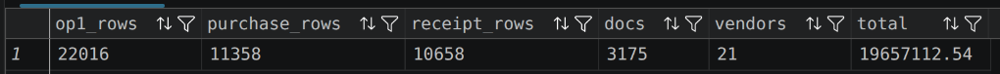
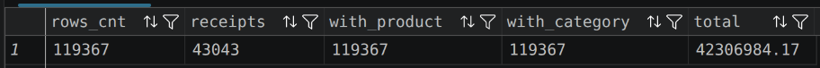
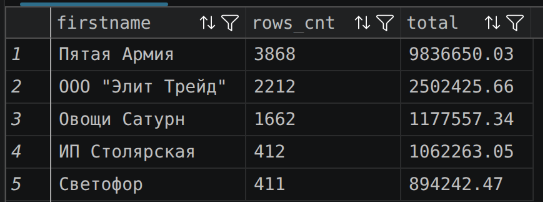
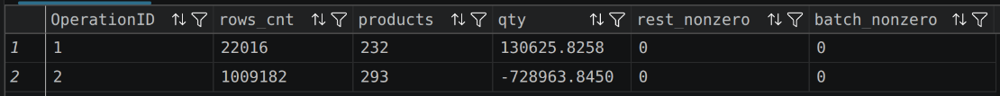
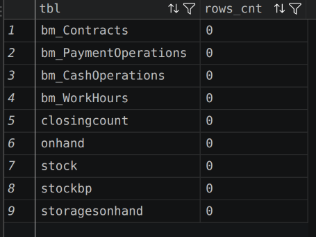

# Front: sql запросы по направлениям

## 1. Закупка продукции

```sql
select count(*) as op1_rows,
       sum(case when d.DocumentTypeID = 4 then 1 else 0 end) as purchase_rows,
       sum(case when d.DocumentTypeID = 6 then 1 else 0 end) as receipt_rows,
       count(distinct case when d.DocumentTypeID = 4 then o.DocumentID end) as docs,
       count(distinct case when d.DocumentTypeID = 4 then o.VendorID end) as vendors,
       sum(case when d.DocumentTypeID = 4 then o.Amount else 0 end) as total
from bm_StorageOperations o
join bm_JournalBarnetDocs d on d.ID = o.DocumentID
left join vendors v on v.id = o.VendorID
left join product p on p.id = o.ProductID
where o.OperationID = 1;
```



Результат: 22 016 строк с OperationID = 1, из них 11 358 закупки (тип 4) и 10 658 строки товарных чеков (тип 6). Закупок 3 175 документов на 21 поставщика, сумма 19 657 112,54.

Подтверждает, что закупка связана с документом, поставщиком и товаром через join, и что одного OperationID = 1 мало, нужен ещё DocumentTypeID = 4. Иначе в выборку попадут строки чеков.

## 2. Продажа товара

```sql
select count(*) as rows_cnt,
       count(distinct j.receiptn) as receipts,
       count(p.id) as with_product,
       count(c.id) as with_category,
       sum(j.amount) as total
from journal j
left join product p on p.productid = j.id
left join category c on cast(c.id as varchar(10)) = j.categoryid
where j.transtype = 101;
```



Результат: 119 367 строк, 43 043 чека, сумма 42 306 984,17. Товар и категорию нашли все 119 367 строк.

Подтверждает, что продажи лежат в journal и отделяются фильтром transtype = 101, а journal.id = product.productid и journal.categoryid = category.id. Категорию приходится приводить к varchar, потому что типы колонок разные.

## 3. Взаимоотношения с поставщиками

```sql
select top 5 v.firstname, count(*) as rows_cnt, sum(o.Amount) as total
from bm_StorageOperations o
join bm_JournalBarnetDocs d on d.ID = o.DocumentID
join vendors v on v.id = o.VendorID
where o.OperationID = 1 and d.DocumentTypeID = 4
group by v.firstname
order by total desc;
```



Подтверждает, что VendorID в закупочных строках заполнен и через join с vendors считается объём по каждому поставщику. В закупках участвует 21 поставщик из 63 в справочнике, ИНН заполнен только у 5.

## 4. Работа персонала

```sql
select sum(case when j.transtype = 101 then 1 else 0 end) as sales_rows,
       sum(case when j.transtype in (386, 387) then 1 else 0 end) as shift_events,
       count(distinct case when j.transtype = 101 then p.personid end) as sales_people,
       count(distinct case when j.transtype in (386, 387) then p.personid end) as shift_people
from journal j
join personnel p on cast(p.personid as varchar(13)) = j.loginid
where j.transtype in (101, 386, 387);
```


Результат: 119 367 продаж и 11 532 события смен. Продажи приходятся на 1 сотрудника, смены на 35.

Подтверждает, что journal.loginid связан с personnel.personid, но для продаж связь бесполезная: во всех строках loginid = 906. Для смен, наоборот, связь рабочая. Считать часы по bm_WorkHours нельзя, таблица пустая, это видно в запросе 6.

## 5. Остатки

```sql
select o.OperationID,
       count(*) as rows_cnt,
       count(distinct o.ProductID) as products,
       sum(o.Count) as qty,
       sum(case when o.Rest <> 0 then 1 else 0 end) as rest_nonzero,
       sum(case when o.BatchID <> 0 then 1 else 0 end) as batch_nonzero
from bm_StorageOperations o
join bm_JournalBarnetDocs d on d.ID = o.DocumentID
group by o.OperationID
order by o.OperationID;
```



Результат: приход 22 016 строк по 232 товарам, списание 1 009 182 строки по 293 товарам. Rest и BatchID нулевые во всех строках.

Подтверждает, что движение товара есть и связано с документами через DocumentID, а остаток можно получить только суммой Count. Партионный учёт не работает, поля Rest и BatchID пустые.

## 6. Пустые таблицы

```sql
select 'bm_Contracts' as tbl, count(*) as rows_cnt from bm_Contracts
union all select 'bm_PaymentOperations', count(*) from bm_PaymentOperations
union all select 'bm_CashOperations', count(*) from bm_CashOperations
union all select 'bm_WorkHours', count(*) from bm_WorkHours
union all select 'closingcount', count(*) from closingcount
union all select 'onhand', count(*) from onhand
union all select 'stock', count(*) from stock
union all select 'stockbp', count(*) from stockbp
union all select 'storagesonhand', count(*) from storagesonhand;
```



Результат: везде 0.

Подтверждает, что договоров, платежей, кассовых операций с поставщиками, табеля и готовых остатков в базе нет. Поэтому задолженность поставщикам, зарплату и остаток на дату по этим таблицам посчитать нельзя.

## Вывод

- Закупки и продажи: данные есть, связи через join работают, объёмы считаются.
- Поставщики: справочник и закупки есть, реквизиты заполнены плохо, договоров и оплат нет.
- Персонал: справочник и смены есть, продажи к сотруднику не привязаны, табеля нет.
- Остатки: движение есть, готовых остатков и партий нет, остаток считается суммой Count.
